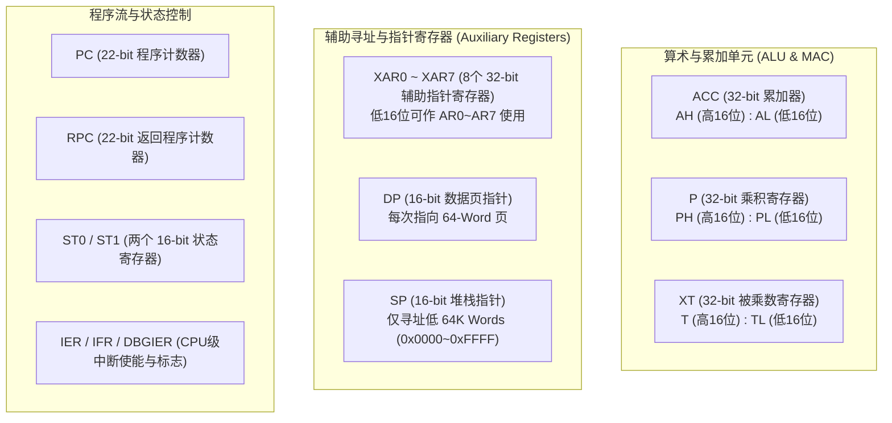
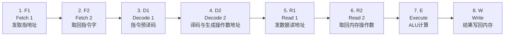

# 02 - C28x CPU 核心寄存器与 8 级流水线

> **关联手册**：*TMS320C28x CPU and Instruction Set Reference Guide (`SPRU430`)*

理解 C28x 内核寄存器与 8 级流水线架构，对于看懂反汇编代码、排查 `ITRAP` 非法中断栈帧以及优化高频控制环路（ISR）至关重要。

---

## 1. C28x CPU 核心寄存器组

C28x 是一颗面向实时数字信号控制（DSC）的 32 位定/浮点混合架构处理器，其核心寄存器均位于 CPU 内部（不占用内存地址空间）：

### 1.1 关键寄存器详解与开发注意事项

| 寄存器 | 位宽 | 核心作用与开发注意点 |
| :--- | :---: | :--- |
| **`ACC` (`AH:AL`)** | 32-bit | 主累加器。C 语言 16/32 位整型运算、返回值（16/32位整型）均通过 `AL` 或 `ACC` 传递。 |
| **`P` (`PH:PL`)** | 32-bit | 硬件 $16 \times 16$ 或 $32 \times 32$ 乘法器的乘积寄存器。 |
| **`XT` (`T:TL`)** | 32-bit | 硬件乘法器的被乘数暂存器，也用于移位位数暂存。 |
| **`XAR0` ~ `XAR7`** | 32-bit | 通用指针/循环计数寄存器。C 函数调用约定中，`XAR4`、`XAR5` 常用于传递指针参数，`XAR1`~`XAR3` 为被调用者保存（Callee-saved）。 |
| **`DP` (Data Page)** | 16-bit | **直接寻址页指针**。C28x 把 4M Words 内存划分为每页 **64 Words**。同一个 `.ebss` 段内相邻全局变量共享 `DP` 时，访问仅需 1 条单字指令，无需每次加载 32 位完整地址！ |
| **`SP` (Stack Pointer)** | 16-bit | **重点限制**：`SP` 只有 **16 位**！这意味着 C28x 的栈段（`.stack`）**必须分配在地址空间的低 64K Words（`0x0000 0000` ~ `0x0000 FFFF`）以内**（通常放在 `M1` 或 `LSx`/`D0` RAM 中）。栈向上生长（入栈后 `SP` 加 1）。 |
| **`PC` / `RPC`** | 22-bit | `PC` 寻址范围 `0x000000 ~ 0x3FFFFF`。调用子函数 (`LCR`) 时，硬件自动将返回地址存入 `RPC`（类似 ARM 的 `LR` 寄存器），减少单层调用的压栈开销。 |
| **`ST0` / `ST1`** | 16-bit | `ST0` 存放算术状态标志（`Z`, `N`, `C`, `V`, `OVM` 饱和模式、`SXM` 符号扩展）；`ST1` 存放系统控制位（**`INTM` 全局中断屏蔽位**、**`EALLOW` 写保护解锁位**、`PAGE0`、`AMODE`）。 |

> [!CAUTION]
> **栈指针 `SP` 的偶数对齐要求**：
> 进入 C 语言函数或中断服务程序（ISR）时，`SP` 常常通过 `ASP`（Align Stack Pointer）指令强制对齐到偶数地址，以保证栈上局部变量中的 32-bit 数据满足偶数地址对齐。

---

## 2. C28x 8 级指令流水线 (8-Stage Pipeline)

C28x 采用非互锁的 8 级哈佛架构流水线（拥有独立的程序读取总线、数据读取总线和数据写入总线），在理想状态下可实现单周期单指令吞吐（1 MIPS / MHz，200 MHz 主频下达 200 MIPS）：

### 2.1 流水线保护与延迟陷阱 (Pipeline Hazards)

1. **CPU 寄存器与片内 SARAM 具备硬件流水线保护**：
   - 当上一条指令正在 `W` 阶段写某块内存，下一条指令在 `R1` 阶段读同一地址时，CPU 硬件会自动插入等待周期（Stall），保证先写后读（RAW）一致性。
2. **外设寄存器（Peripheral Frame 0/1/2）与部分系统寄存器的流水线延迟**：
   - 修改外设配置寄存器（如 `GPIO` 方向、时钟使能 `PCLKCRx`、X-BAR 路由）后，指令在 `W` 阶段才真正写出，外设硬件生效还需要 1~2 个 `SYSCLK` 周期。
   - **典型现象**：刚开启某外设时钟 `CpuSysRegs.PCLKCR2.bit.EPWM1 = 1;`，紧接着下一行立刻写 `EPwm1Regs.TBPRD = 1000;`，可能因为时钟门控尚未完成开启导致第一次写入丢失！
   - **解决办法**：在开启外设时钟或切换关键硬件状态后，插入 `asm(" RPT #5 || NOP");`（延时 6 个周期），或者直接使用 TI DriverLib 的 `SysCtl_enablePeripheral()`（内部已包含流水线同步等待）。
3. **Flash 取指瓶颈与分支跳转惩罚**：
   - 在 200 MHz 主频下，片上 Flash 的读取速度约为 50 MHz（需配置 `RWAIT = 3` 即 3 个等待周期）。
   - 虽然 Flash 控制器带有 **128-bit 预取缓冲器（Prefetch Buffer）**，在顺序执行代码时能掩盖等待周期；但一旦遇到 **`if-else` 分支跳转、函数调用或进入中断（ISR）**，预取队列失效（Pipeline Flush），CPU 必须停顿等待 Flash 重新读取，造成数个到十几个周期的延迟。
   - **优化结论**：高频执行的中断服务函数（ISR）和控制律代码，**必须通过 `.TI.ramfunc` 搬移到零等待周期（0-Wait-State）的 RAM 中运行**（详见 [02_memory_and_linker/04_flash_to_ram_execution.md](../02_memory_and_linker/04_flash_to_ram_execution.md)）。
