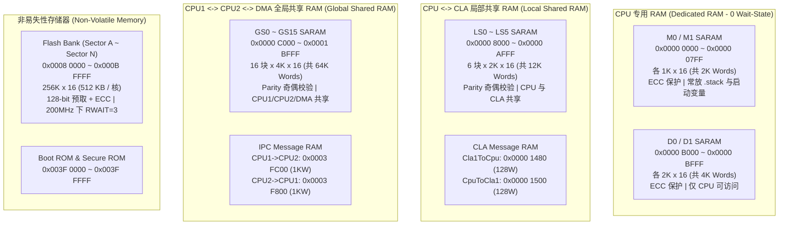

# 01 - TMS320F2837xD 内存映射与物理分区总览 (Memory Map)

> **关联手册**：
> - *TMS320F2837xD Technical Reference Manual (`SPRUHM8K`)* 第 2.12 节 "Memory Controller Module"
> - *TMS320F2837xD Data Manual (`SPRS880`)* 第 6.3 节 "Memory Maps"

在 C2000 中，RAM 并不是一整块连续无差别的内存，而是按**访问权限、主控器归属（CPU1 / CPU2 / CLA / DMA）以及安全校验特性（ECC / Parity）**划分为多类独立的物理块（Blocks）。理解这些物理分区的特性是编写 `.cmd` 链接脚本和分配双核/DMA/CLA 内存的前提。

---

## 1. F2837xD 内存架构全景图（单核视角 + 核间共享）

---

## 2. 各大内存分区详细地址表与访问权限矩阵

> **注**：表中大小单位 `K x 16` 表示 `1024 个 16-bit Word`（即 `2 KB`）。C28x 地址每增加 `1` 代表 `1 个 16-bit Word`。

| 内存块名称 | 起始地址 | 结束地址 | 单块大小 (Words) | CPU 访问 | CLA 访问 | DMA 访问 | 典型工程用途 |
| :--- | :--- | :--- | :---: | :---: | :---: | :---: | :--- |
| **`M0` RAM** | `0x0000 0000` | `0x0000 03FF` | `1K x 16` | 读/写/取指 | ❌ | ❌ | 仿真启动入口、高频小变量（注意 `0x0000~0x0123` 被 Boot ROM 占用） |
| **`M1` RAM** | `0x0000 0400` | `0x0000 07FF` | `1K x 16` | 读/写/取指 | ❌ | ❌ | **系统堆栈 `.stack` 默认首选区**（位于低 64K 内且 0 等待） |
| **`Cla1ToCpuMsgRAM`** | `0x0000 1480` | `0x0000 14FF` | `128 x 16` | 只读 | 读/写 | ❌ | CLA 向 CPU 传递控制计算结果 |
| **`CpuToCla1MsgRAM`** | `0x0000 1500` | `0x0000 157F` | `128 x 16` | 读/写 | 只读 | ❌ | CPU 向 CLA 传递目标给定或配置参数 |
| **`LS0` ~ `LS5`** | `0x0000 8000` | `0x0000 AFFF` | `6 × 2K x 16` | 读/写/取指 | 读/写/取指(需授权) | ❌ | **`.TI.ramfunc` 高频中断函数**、`.ebss` 变量、或划给 CLA 作代码/数据区 |
| **`D0` / `D1`** | `0x0000 B000` | `0x0000 BFFF` | `2 × 2K x 16` | 读/写/取指 | ❌ | ❌ | CPU 核心私有数据（带 ECC）、若 `.stack` 超过 1K 可移至 `D0`/`D1` |
| **`GS0` ~ `GS15`** | `0x0000 C000` | `0x0001 BFFF` | `16 × 4K x 16` | 读/写/取指 | ❌ | **读/写** | **DMA 缓冲区**（唯一支持 DMA 的 RAM！）、大数组/波形缓存、双核共享数据 |
| **`CPU2TOCPU1RAM`** | `0x0003 F800` | `0x0003 FBFF` | `1K x 16` | CPU1只读 / CPU2读写 | ❌ | **读/写** | 双核 IPC 固定方向消息传递（CPU2 发往 CPU1） |
| **`CPU1TOCPU2RAM`** | `0x0003 FC00` | `0x0003 FFFF` | `1K x 16` | CPU1读写 / CPU2只读 | ❌ | **读/写** | 双核 IPC 固定方向消息传递（CPU1 发往 CPU2） |
| **`FLASH` (A~N)** | `0x0008 0000` | `0x000B FFFF` | `14 Sectors (共256KW)` | 只读/取指 | ❌ | ❌ | 存放固件代码 `.text`、常量 `.econst`、初始化表 `.cinit` |

---

## 3. 硬件设计上的三大铁律（必背！）

### 铁律 1：DMA 只能访问 `GS0` ~ `GS15` 和双核 `MsgRAM`！
**新手最常见 Bug**：定义了一个普通全局数组 `uint16_t adcBuf[256];`，默认被链接器放进了 `.ebss`（通常映射在 `LS5` 或 `M0/D0`），然后配置 DMA 把 `AdcaResultRegs` 搬运到 `adcBuf`。结果程序运行后 `adcBuf` 全是 `0`！
- **原因**：DMA 总线根本没有连接到 `M0/M1`、`D0/D1` 或 `LS0~LS5`！DMA 只能访问 **外设寄存器**、**`GS0~GS15` 全局共享 RAM** 以及 **IPC Message RAM**。
- **正确做法**：所有 DMA 源/目的 RAM 数组，必须使用 `#pragma DATA_SECTION(adcBuf, "ramgs0")` 显式放入 `GSx` RAM 中。

### 铁律 2：CLA 只能访问 `LS0` ~ `LS5` 和 CLA `MsgRAM`！
CLA 协处理器无法访问 `M0/M1`、`D0/D1` 或 `GS0~GS15`。
- 若要让 CLA 执行代码，必须由 CPU 通过寄存器 `MemCfgRegs.LSxMSEL.bit.MSEL_LS0 = 1` 将某块 `LSx` 划归 CLA，再通过 `MemCfgRegs.LSxCLAPGM.bit.CLAPGM_LS0 = 1` 将其设为 CLA 程序区（详见 [06_accelerators_and_multicore/01_cla_control_law_accelerator.md](../06_accelerators_and_multicore/01_cla_control_law_accelerator.md)）。

### 铁律 3：`GS0` ~ `GS15` 在双核下的写权限互斥
在 F2837xD 双核系统中，`GS0` ~ `GS15` 是两个核物理上共享的同一片 64K Words 内存：
- **默认状态（复位后）**：`GS0` ~ `GS15` 的主控权（Master Ownership）**全部属于 CPU1**：
  - **CPU1（主控方）**：可读、可写、可执行指令，CPU1 的 DMA 也可读可写。
  - **CPU2（非主控方）**：**只能读（Read-Only）**！CPU2 或 CPU2 的 DMA 尝试写入未授权的 `GSx` 块会被硬件直接丢弃（写无效）！
- **如何授权给 CPU2**：必须由 **CPU1** 调用 `MemCfg_setGSRAMMasterSel(MEMCFG_SECT_GS8, MEMCFG_GSRAMMASTER_CPU2)`（或写 `MemCfgRegs.GSxMSEL`），把某块（如 `GS8~GS15`）移交给 CPU2，此时变成 **CPU2 可读写、CPU1 只读**。

---

## 4. Flash 扇区结构与等待周期 (Wait-States)

F2837xD 每个 CPU 核拥有独立的 **256K x 16（512 KB）Flash**，分为 14 个扇区（`Sector A` ~ `Sector N`）：
- **`Sector A` 的起始地址 `0x0008 0000`**：这是芯片配置为 **Flash Boot 模式** 时，Boot ROM 跳转进入用户程序的固定硬件入口地址（`BEGIN` / `codestart` 段必须放在 `0x080000`，占 2 个 Words）。
- **擦写粒度**：Flash 最小擦除单位是 **1 个 Sector**（`Sector A~D` 和 `K~N` 每块为 `8K x 16`，`Sector E~J` 每块为 `32K x 16`），最小编程（写入）对齐粒度通常为 64-bit / 128-bit（结合 ECC）。
- **Flash 等待周期 (`RWAIT`)**：
  - 在 200 MHz `SYSCLK` 下，Flash 必须在 RAM 中调用 `InitFlash()` / `Flash_initModule()` 配置 **`RWAIT = 3`**，并开启 **预取缓冲（Prefetch）** 和 **数据缓存（Data Cache）**。
  - **严禁在 Flash 内部执行修改 Flash 控制器寄存器（如 `FrdCntlRegs.RWAIT`）的代码**，否则会直接触发硬件非法指令中断 (`ITRAP`)！
