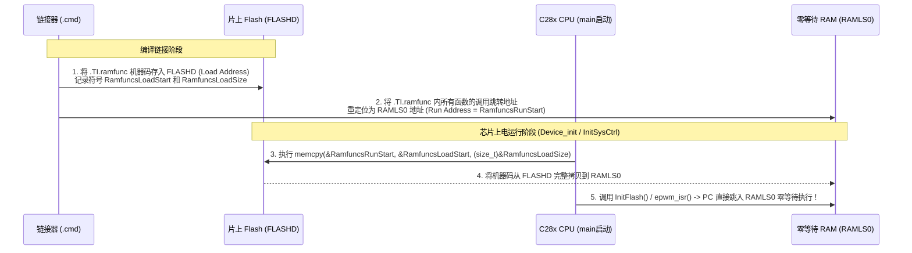

# 04 - Flash 代码搬移至 RAM 运行全流程 (`.TI.ramfunc`)

> **关联手册**：*Running an Application from Internal Flash Memory on the TMS320F28xxx DSP (`SPRA958`)*

在 C2000 开发中，初期调试通常使用 `2837xD_RAM_lnk_cpu1.cmd`（仿真器直接把所有代码下载到 RAM，断电即失）。当转入实际产品固化时，必须切换到 `2837xD_FLASH_lnk_cpu1.cmd`。

从 RAM 工程切换到 Flash 工程时，必须把两类代码**在编译时存放在 Flash（`LOAD`），在上电启动后复制到零等待 RAM（`RUN`）中执行**：
1. **必须搬移（否则硬件崩溃）**：Flash 等待周期初始化函数（`InitFlash()` / `Flash_initModule()`）以及微秒级延时函数 `DSP28x_usDelay`。
2. **强烈建议搬移（性能优化）**：高频中断服务函数（如 20kHz~100kHz 的 `adc_isr` / `epwm_isr`）及核心 PID / FOC 控制算法。

---

## 1. 工作原理图解



> [!DANGER]
> **致命陷阱：未执行 `memcpy` 就调用 `.TI.ramfunc` 函数！**
> 因为链接器已经把 `InitFlash()` 的调用地址改成了 `RAMLS0` 的地址，如果你在 `main()` 开头忘了执行 `memcpy(RamfuncsRunStart, ...)` 就直接调用 `InitFlash()`，CPU 会跳到尚未初始化的全 0（或乱码）RAM 区取指，立刻触发 **`ILLEGAL_ISR` (`ITRAP0` 非法指令中断)** 死机！

---

## 2. 完整实操三步法

### 第一步：在 `.cmd` 链接脚本中配置 `.TI.ramfunc`

在 Flash 链接脚本（如 `2837xD_FLASH_lnk_cpu1.cmd`）中确保有以下配置：

```text
SECTIONS
{
    .TI.ramfunc : {} LOAD = FLASHD,
                     RUN = RAMLS0,
        #if defined(__TI_EABI__)
                     LOAD_START(RamfuncsLoadStart),
                     LOAD_SIZE(RamfuncsLoadSize),
                     LOAD_END(RamfuncsLoadEnd),
                     RUN_START(RamfuncsRunStart),
                     RUN_SIZE(RamfuncsRunSize),
                     RUN_END(RamfuncsRunEnd),
        #else
                     LOAD_START(_RamfuncsLoadStart),
                     LOAD_SIZE(_RamfuncsLoadSize),
                     LOAD_END(_RamfuncsLoadEnd),
                     RUN_START(_RamfuncsRunStart),
                     RUN_SIZE(_RamfuncsRunSize),
                     RUN_END(_RamfuncsRunEnd),
        #endif
                     PAGE = 0, ALIGN(8)
}
```

### 第二步：在 C 代码中标记需要搬入 RAM 的函数

```c
// 使用编译器属性将控制环路中断标记到 .TI.ramfunc 段
__attribute__((ramfunc))
__interrupt void controlLoopISR(void)
{
    // 1. 读取 ADC 结果
    // 2. 执行双闭环 PI / Clarke / Park 运算
    // 3. 更新 ePWM CMPA 占空比
    // 4. 清除中断标志与 PIEACK
}
```

### 第三步：在 `main()` 初始化早期执行 `memcpy` 并初始化 Flash

#### 方式 A：使用 C2000Ware DriverLib 标准框架 (`device.c`)
在 C2000Ware 的 `device.h` / `device.c` 中，当工程预定义了宏 **`_FLASH`** 时，`Device_init()` 内部已经自动帮你写好了 `memcpy` 和 `Flash_initModule()`：

```c
#include "driverlib.h"
#include "device.h"

void main(void)
{
    // Device_init() 内部当定义了 _FLASH 宏时，会自动执行：
    // 1. memcpy(&RamfuncsRunStart, &RamfuncsLoadStart, (size_t)&RamfuncsLoadSize);
    // 2. Flash_initModule(FLASH0CTRL_BASE, FLASH0ECC_BASE, DEVICE_FLASH_WAITSTATES);
    Device_init();

    // 后续外设与中断初始化...
}
```

#### 方式 B：手写底层代码（Bitfield 传统工程或自定义启动）
```c
#include <string.h>
#include "F28x_Project.h"

// 声明由链接器 (.cmd) 生成的地址符号（注意：它们不是普通变量，必须取地址 & 使用！）
extern uint16_t RamfuncsLoadStart;
extern uint16_t RamfuncsLoadSize;
extern uint16_t RamfuncsRunStart;

void main(void)
{
    InitSysCtrl(); // 初始化看门狗、PLL时钟与外设时钟门控

#ifdef _FLASH
    // 【关键1】必须先将 .TI.ramfunc 从 Flash 拷贝到 RAM！
    memcpy(&RamfuncsRunStart, &RamfuncsLoadStart, (size_t)&RamfuncsLoadSize);

    // 【关键2】再去调用已经在 RAM 中的 InitFlash() 配置等待周期与预取缓存！
    InitFlash();
#endif

    // 后续中断与外设初始化...
}
```

> [!IMPORTANT]
> **为什么 `RamfuncsLoadSize` 也要加取地址符 `&`？**
> 因为链接器生成的符号（Linker Symbol）本质上保存在符号表的“地址字段”中，并不占用任何实际内存单元。在 C 语言中，只有对符号取地址 `(size_t)&RamfuncsLoadSize`，拿到的才是链接器计算出来的段大小数值！千万不要写成 `(size_t)RamfuncsLoadSize`（那样会去读取以 Size 数值为地址的内存内容，导致拷贝长度完全错误）。
