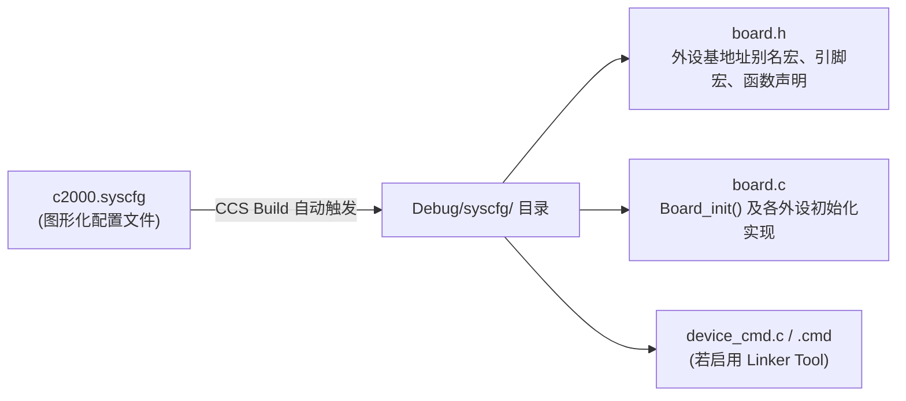

# 03 - SysConfig 图形化配置工具工作流指南

> **适用版本**：CCS v11+ & C2000Ware v4.0+

**TI SysConfig** 是内置于 CCS（也可独立运行）的图形化外设与引脚配置工具（类似 STM32CubeMX，但它是**实时跟随工程编译动态生成 `board.c` / `board.h`**，而不是一次性生成后脱离）。

---

## 1. SysConfig 的核心优势（专门解决 C2000 痛点）

C2000 的外设极其强大但也极其繁琐（例如配一路带死区和 CMPSS 过流封波的 ePWM，涉及到 GPIO Mux $\rightarrow$ Input/ePWM X-BAR $\rightarrow$ CMPSS $\rightarrow$ ePWM TB/CC/AQ/DB/TZ/ET 共几十个寄存器）。SysConfig 解决了三大痛点：
1. **硬件冲突实时检查**：引脚复用冲突、X-BAR 通道冲突、时钟分频超限会立刻标红报错。
2. **自动处理外设初始化顺序**：例如自动在配置所有 ePWM 之前插入 `SysCtl_disablePeripheral(SYSCTL_PERIPH_CLK_TBCLKSYNC)`，配完后再自动打开 `TBCLKSYNC`，无需手写防错。
3. **所见即所得的代码预览**：右侧栏实时显示生成的 `board.c` 和 `board.h` DriverLib C 代码，是**学习 DriverLib API 标准调用套路的最佳活教材**！

---

## 2. SysConfig 编译生成机制与工程融合

当工程根目录存在一个 `.syscfg` 文件（如 `c2000.syscfg`）时，每次点击 **Build Project**，CCS 会先调用 SysConfig 引擎，在编译输出目录 `CPU1_RAM/syscfg/`（或 `Debug/syscfg/`）下自动生成以下文件：



### 2.1 在 `main.c` 中调用的标准模板

使用 SysConfig 后，`main.c` 的初始化代码极度清爽：

```c
#include "driverlib.h"
#include "device.h"
#include "board.h"   // 【核心】包含 SysConfig 自动生成的头文件

void main(void)
{
    // 1. 初始化系统时钟、看门狗、Flash等待周期与外设时钟门控
    Device_init();

    // 2. 初始化 GPIO 锁
    Device_initGPIO();

    // 3. 初始化 PIE 中断控制器与默认向量表
    Interrupt_initModule();
    Interrupt_initVectorTable();

    // 4. 【核心】一键执行所有在 SysConfig 界面中配置好的外设、GPIO、X-BAR 与中断绑定！
    Board_init();

    // 5. 开启全局中断与实时调试中断
    EINT;
    ERTM;

    for(;;)
    {
        // 主循环任务
    }
}
```

### 2.2 利用 `board.h` 生成的语义化宏解耦业务代码

在 SysConfig 中，如果你把 `EPWM1` 模块实例命名为 `myBoostPWM`，把一个 GPIO 命名为 `LED_HEARTBEAT`，`board.h` 会自动生成宏：
```c
// 自动生成于 board.h：
#define myBoostPWM_BASE        EPWM1_BASE
#define LED_HEARTBEAT          31U
#define LED_HEARTBEAT_GPIO_CFG GPIO_31_GPIO31
```
在你的控制算法 `.c` 文件中，只需要 `#include "board.h"`，然后写：
```c
EPWM_setCounterCompareValue(myBoostPWM_BASE, EPWM_COUNTER_COMPARE_A, dutyTicks);
GPIO_togglePin(LED_HEARTBEAT);
```
如果将来硬件改版把 `EPWM1` 换成了 `EPWM4`，只需在 `.syscfg` 下拉框里改一下引脚，**业务控制代码一行都不用改**！
