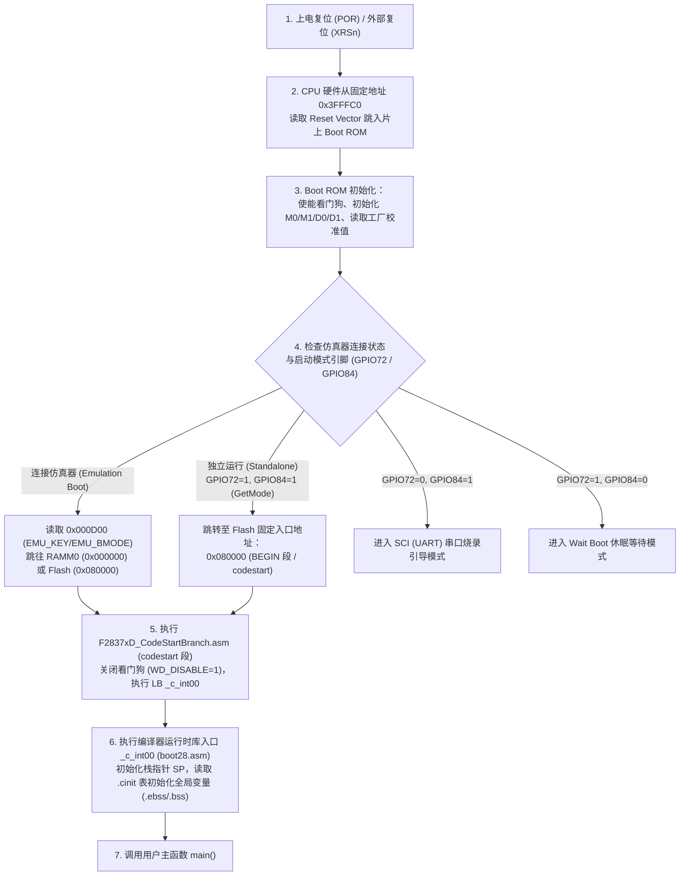

# 01 - 芯片上电启动流程：从复位向量、Boot ROM 到 `main()`

> **关联手册**：*TMS320F2837xD Technical Reference Manual (`SPRUHM8K`)* 第 3 章 "System Control" & 第 4 章 "ROM Code and Peripheral Booting"

理解 C2000 从按下复位键（或上电 POR）到执行 `main()` 第一行代码之间发生了什么，是排查**“拔掉仿真器后板子不启动”**、**“上电期间看门狗提前复位”**等问题的根本。

---

## 1. 上电启动全链路时序图



---

## 2. 启动模式引脚配置 (`GPIO72` 与 `GPIO84`)

在脱离仿真器独立上电（Standalone Boot）时，CPU1 的 Boot ROM 会读取 **GPIO72 (`BOOTPIN0`)** 和 **GPIO84 (`BOOTPIN1`)** 的外部电平来决定启动介质：

| GPIO84 电平 | GPIO72 电平 | 启动模式名称 | 行为描述 |
| :---: | :---: | :--- | :--- |
| **`1` (上拉)** | **`1` (上拉)** | **GetMode (默认等同于 Flash Boot)** | 若未烧写 OTP 自定义启动配置，默认直接跳转到 **Flash 起始地址 `0x080000`** 运行用户程序！ |
| **`1` (上拉)** | **`0` (接地)** | **SCI Boot** | 通过 `SCIA` (GPIO84/85 或 GPIO28/29) 接收上位机串口发来的字节流装入 RAM 运行（用于无仿真器串口升级）。 |
| **`0` (接地)** | **`1` (上拉)** | **Wait Boot** | 关看门狗并在死循环里等待仿真器挂载（当用户写了错误的死锁代码锁死 JTAG 时，切到 Wait Boot 即可救砖！）。 |
| **`0` (接地)** | **`0` (接地)** | **Parallel I/O Boot** | 通过并行 GPIO 口加载程序。 |

> [!IMPORTANT]
> **硬件原理图设计铁律**：
> `GPIO72` 和 `GPIO84` 在硬件上必须设计上拉电阻（或确保上电瞬间不被外围电路拉低），否则芯片上电会意外进入 `SCI Boot` 或 `Wait Boot`，表现为**“插着仿真器能跑，拔掉仿真器重新上电就死机不工作”**！

---

## 3. 为什么需要 `F2837xD_CodeStartBranch.asm`？

在每个 C2000 工程中，都包含一个只有几十行的汇编文件 `F2837xD_CodeStartBranch.asm`：

```asm
WD_DISABLE  .set  1         ; 设为 1：在进入 _c_int00 之前先关闭看门狗！

    .sect "codestart"       ; 该段在 .cmd 中被固定分配在 BEGIN (Flash 0x080000 或 M0 0x000000)
code_start:
    .if WD_DISABLE == 1
        LB wd_disable       ; 跳转到下方关看门狗代码
    .else
        LB _c_int00         ; 直接跳往 C 语言运行库初始化入口
    .endif

wd_disable:
    SETC OBJMODE            ; 切换到 C28x 32位目标模式
    EALLOW                  ; 解锁受保护寄存器
    MOVZ DP, #7029h>>6      ; 指向 WdRegs.WDCR (地址 0x7029)
    MOV @7029h, #0068h      ; 写入 0x0068 禁用看门狗
    EDIS
    LB _c_int00             ; 跳入 C 运行时库初始化
```

### 3.1 它的两大关键使命：
1. **充当定点跳板（Trampoline）**：
   Boot ROM 只知道无脑跳去 `0x080000`（`BEGIN` 区域只有 2 个 Words 大小），而 `_c_int00` 和 `main()` 编译后可能位于 `FLASHB`（如 `0x082340`）。`codestart` 段在 `0x080000` 放一条 2-Word 长度的长跳转指令 `LB wd_disable` / `LB _c_int00`，完成入口引导。
2. **防止大工程在进入 `main()` 前被看门狗咬死**：
   芯片复位后**硬件看门狗默认是开启的**（约几毫秒就会超时复位）！如果工程中有大量全局数组需要 `_c_int00` 花费数毫秒去拷贝 `.cinit` 初始化表，可能还没跑进 `main()` 第一行的 `SysCtl_disableWatchdog()`，芯片就已经看门狗超时无限重启了！因此在 `codestart` 汇编阶段先行关闭看门狗是最稳妥的做法。
