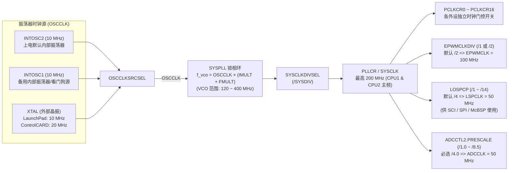

# 02 - 系统时钟树 (`PLL`)、外设时钟分频与看门狗机制

> **关联手册**：*TMS320F2837xD Technical Reference Manual (`SPRUHM8K`)* 第 3.7 节 "Clocking" & 第 3.9 节 "Watchdog Timer"

---

## 1. F2837xD 系统时钟树架构图



---

## 2. 锁相环 (SYSPLL) 倍频与分频计算公式

当启用 PLL 时，系统主频 $f_{\text{SYSCLK}}$ 的计算公式为：

$$f_{\text{SYSCLK}} = \frac{f_{\text{OSCCLK}} \times (\text{IMULT} + \text{FMULT})}{\text{SYSDIV}}$$

其中硬件约束条件为：
1. **整数倍频系数 `IMULT`**：`1 ~ 127`
2. **小数倍频系数 `FMULT`**：`0`, `0.25`, `0.5`, `0.75`
3. **压控振荡器频率 $f_{\text{VCO}} = f_{\text{OSCCLK}} \times (\text{IMULT} + \text{FMULT})$ 必须严格落在 `120 MHz ~ 400 MHz` 之间**！
4. **系统分频系数 `SYSDIV`**：为了保证输出时钟占空比严格为 50%，**推荐至少分频 `/2`**（即先把 $f_{\text{VCO}}$ 倍频到 `400 MHz`，再通过 `SYSDIV = 2` 分频得到 `200 MHz`）。

### 2.1 常见开发板的标准配置参数

| 开发板型号 | 外部晶振 $f_{\text{OSCCLK}}$ | `IMULT` | `FMULT` | $f_{\text{VCO}}$ | `SYSDIV` | 最终 $f_{\text{SYSCLK}}$ |
| :--- | :---: | :---: | :---: | :---: | :---: | :---: |
| **LAUNCHXL-F28379D (LaunchPad)** | **10 MHz** | `40` | `0` | `400 MHz` | `/2` | **200 MHz** |
| **TMDSCNCD28379D (ControlCARD)** | **20 MHz** | `20` | `0` | `400 MHz` | `/2` | **200 MHz** |
| **使用内部振荡器 `INTOSC2`** | **10 MHz** | `38` | `0.75` | `387.5 MHz` | `/2` | **193.75 MHz**（考慮内部晶振正负偏差留裕量） |

---

## 3. 容易忽略的三大子时钟域

1. **`EPWMCLK`（默认 100 MHz！）**：
   - 在 F2837xD 中，为了兼容旧芯片的 16-bit `TBPRD` 范围，复位后 `ClkCfgRegs.PERCLKDIVSEL.bit.EPWMCLKDIV` 默认值为 **`1`（即 `SYSCLK / 2 = 100 MHz`）**！
   - 算 PWM 周期 `TBPRD` 时，一定要先确认 `EPWMCLK` 是 `100 MHz` 还是被改成了 `200 MHz`！
2. **`LSPCLK`（低速外设时钟，默认 50 MHz）**：
   - **SCI (UART)** 和 **SPI** 的波特率发生器时钟源**不是 `SYSCLK`，而是 `LSPCLK`**！
   - 复位后 `ClkCfgRegs.LOSPCP.bit.LSPCLKDIV = 2`（代表 `/4` 分频，即 `200 MHz / 4 = 50 MHz`）。
3. **`ADCCLK`（最高 50 MHz）**：
   - 每个 ADC 模块内部有独立分频器 `AdcRegs.ADCCTL2.bit.PRESCALE`。
   - **注意**：ADC 的采样保持窗口 `ACQPS` 计数的基准是 **`SYSCLK`（200 MHz，每格 5ns）**，而转换过程（12-bit 约 10.5 个 ADCCLK 周期）的基准才是 `ADCCLK`（50 MHz）！

---

## 4. 看门狗定时器 (Watchdog Timer)

看门狗由内部独立 10MHz 振荡器 `INTOSC1` 经过固定 512 分频后驱动一个 8-bit 计数器（溢出周期默认约 $13.1\text{ ms}$）：

### 4.1 `WDCR` 寄存器的防误改校验位 (`WDCHK`)
不管你是关闭看门狗、开启看门狗还是修改看门狗分频，写入 `WdRegs.WDCR.all` 时，**Bit[5:3] (`WDCHK`) 必须恒定写入二进制 `101`（即十六进制的 `0x0028`）**！如果写成了 `000` 或其他值，硬件认为软件跑飞误写，**会立刻触发芯片复位**！

```c
// 1. 禁用看门狗：Bit6 (WDDIS)=1 + Bit[5:3] (WDCHK)=101b => 0x0040 | 0x0028 = 0x0068
EALLOW;
WdRegs.WDCR.all = 0x0068U;
EDIS;
// 等价 DriverLib API：SysCtl_disableWatchdog();

// 2. 启用看门狗：Bit6 (WDDIS)=0 + Bit[5:3] (WDCHK)=101b => 0x0028
EALLOW;
WdRegs.WDCR.all = 0x0028U;
EDIS;
// 等价 DriverLib API：SysCtl_enableWatchdog();

// 3. 喂狗序列：必须先后向 WDKEY 写入 0x55 和 0xAA 才能清零看门狗计数器！
EALLOW;
WdRegs.WDKEY.bit.WDKEY = 0x0055U;
WdRegs.WDKEY.bit.WDKEY = 0x00AAU;
EDIS;
// 等价 DriverLib API：SysCtl_serviceWatchdog();
```
