# 04 - PIE 三级中断体系、响应流程与软件中断嵌套

> **关联手册**：*TMS320F2837xD Technical Reference Manual (`SPRUHM8K`)* 第 3.4 节 "Peripheral Interrupt Expansion (PIE)"

C28x CPU 内核本身只有 14 个可屏蔽中断输入引脚（`INT1` ~ `INT14`），而 F2837xD 芯片上有将近 200 个外设中断源！为此，TI 设计了 **PIE（Peripheral Interrupt Expansion，外设中断扩展控制器）**，将 `INT1` ~ `INT12` 每组复用扩展为 16 个通道（$12 \times 16 = 192$ 个外设中断）。

---

## 1. 三级中断链路全景图

一个外设事件（如 `ADCA1` 转换完成或 `ePWM1` 计数过零）要想真正触发 CPU 执行你的 `__interrupt void myISR(void)`，**必须连续闯过三道关卡（共 6 个开关）**：

```mermaid
flowchart LR
    subgraph "第一级：外设级 (Peripheral)"
        P_FLG["1. 外设中断标志位<br/>(如 AdcaRegs.ADCINTFLG.ADCINT1<br/>或 EPwm1Regs.ETFLG.INT)"]
        P_EN["2. 外设中断使能位<br/>(如 AdcaRegs.ADCINTSEL1N2.INT1E<br/>或 EPwm1Regs.ETSEL.INTEN)"]
        P_FLG --> P_EN
    end

    subgraph "第二级：PIE 控制器级 (12 Groups x 16 Channels)"
        PIE_IFR["3. PIE 组内标志位<br/>PieCtrlRegs.PIEIFRx.bit.INTy"]
        PIE_IER["4. PIE 组内使能位<br/>PieCtrlRegs.PIEIERx.bit.INTy"]
        PIE_ACK["5. PIE 组应答锁存门禁<br/>PieCtrlRegs.PIEACK.bit.ACKx == 0<br/>(若为 1 则阻塞同组所有后续中断!)"]
        PIE_IFR --> PIE_IER --> PIE_ACK
    end

    subgraph "第三级：CPU 内核级 (C28x Core)"
        CPU_IFR["6. CPU 级标志位<br/>IFR (Bit 0 ~ 13)"]
        CPU_IER["7. CPU 级组使能位<br/>IER |= M_INTx"]
        CPU_INTM["8. 全局中断总开关<br/>ST1.INTM == 0 (EINT)"]
        CPU_IFR --> CPU_IER --> CPU_INTM
    end

    P_EN -->|"发送脉冲"| PIE_IFR
    PIE_ACK -->|"向 CPU 发送 INTx 请求"| CPU_IFR
    CPU_INTM -->|"从 PieVectTable 取地址"| ISR["执行 __interrupt void myISR()"]
```



---

## 2. 为什么中断只进了一次就再也不进了？（经典新手三连问）

当你发现某个中断上电后**只进去执行了 1 次**，此后再也不触发时，99% 是漏掉了中断退出前的两个清除动作之一：

1. **必须清除外设自身的中断标志位**：
   - 例如在 ePWM 中断里漏写了 `EPWM_clearEventTriggerInterruptFlag(EPWM1_BASE);`（即 `EPwm1Regs.ETCLR.bit.INT = 1;`）。因为外设向 PIE 发送的是边沿脉冲，如果外设标志位一直为 `1`，它就无法再产生下一个上升沿脉冲送给 PIE！
2. **必须清除 PIE 组应答锁存位 (`PIEACK`)**：
   - 当 PIE 的第 $x$ 组向 CPU 送出中断请求时，硬件会自动把 `PieCtrlRegs.PIEACK.bit.ACKx` 置为 `1`（相当于把第 $x$ 组的大门锁上，防止同组其他中断立刻涌入冲掉现场）。
   - 在 ISR 结束前，**必须向该位写 `1` 清零**（`Interrupt_clearACKGroup(INTERRUPT_ACK_GROUPx);` 或 `PieCtrlRegs.PIEACK.all = PIEACK_GROUPx;`），大门才会重新打开！

---

## 3. C2000 的默认中断优先级与“不可抢占”机制

### 3.1 硬件默认行为：一旦进入任何 ISR，全局中断自动关闭！
与 ARM Cortex-M 的 NVIC（默认支持高优先级硬件自动抢占低优先级）**完全不同**：
- 在 C28x 中，当 CPU 响应任何一个中断进入 ISR 的瞬间，**硬件会自动执行：**
  1. 将当前的 `IER`、`ST1`、`PC` 等寄存器压栈；
  2. 将对应的 `IER` 位清零；
  3. **将全局中断屏蔽位 `ST1.INTM` 置 `1`（即自动执行 `DINT` 关闭所有可屏蔽中断）**！
- **这意味着**：在默认情况下，**C2000 的中断是不支持互相抢占（嵌套）的**！哪怕你正在执行最低优先级的 `SCIA_RX` 串口中断（Group 9），此时最高优先级的 `ADCA1` 控制环路中断（Group 1）来了，也必须排队等串口中断执行完 `IRET` 退出后才能响应！

---

## 4. 如何实现软件中断嵌套（让高优先级控制环路抢占低优先级中断）？

如果你的工程中既有高频强实时中断（如 `Group 1` 的 `ADCA1` 或 `Group 3` 的 `EPWM1`），又有耗时较长的低优先级中断（如 `Group 9` 的 `SCIA` 串口解析），可以在**低优先级中断函数开头**手动开启中断嵌套：

```c
// 示例：在低优先级的 SCIA 接收中断 (Group 9) 中，允许 Group 1 (ADC) 和 Group 3 (ePWM) 抢占它！
__interrupt void sciaRxISR(void)
{
    // 1. 临时保存当前 CPU 级 IER 寄存器（其实硬件已压栈，但若后续需局部屏蔽可备份）
    uint16_t tempPIEIER = PieCtrlRegs.PIEIER9.all;

    // 2. 在 CPU 级 IER 中，只保留允许抢占本中断的高优先级组 (如 Group 1 和 Group 3)
    IER |= (M_INT1 | M_INT3);
    IER &= (M_INT1 | M_INT3); // 屏蔽同级(Group 9)及其他更低优先级组

    // 3. 提前释放 Group 9 的 PIEACK，但先清零 PIEIER9 防止同组第 9 组内中断重入自己
    PieCtrlRegs.PIEIER9.all &= 0x0000U;
    PieCtrlRegs.PIEACK.all = PIEACK_GROUP9;
    asm(" NOP");              // 必须等待 1 个周期让 PIEACK 生效

    // 4. 【核心】手动重新打开全局中断总开关！此时 Group 1 和 Group 3 随时可以抢占进来！
    EINT;

    // ================== 执行较耗时的低优先级串口数据处理 ==================
    processSciRxData();
    // ====================================================================

    // 5. 退出前先关全局中断，恢复 PIEIER9 配置（CPU 级 IER 会在 IRET 时由硬件自动从栈中恢复）
    DINT;
    PieCtrlRegs.PIEIER9.all = tempPIEIER;
}
```
> [!TIP]
> **更简单的工程实践建议**：
> 与其编写复杂的软件中断嵌套，不如遵循实时控制软件的黄金设计原则：**只在高频控制中断（ADC/ePWM）和硬件故障中断（TZ）上开启中断，而把 UART/CAN/SPI 等低速通信改为 FIFO 轮询或 DMA 搬运，放在 `main()` 的 `for(;;)` 后台主循环中处理**！这样既从根源上消除了控制环路的中断抖动（Jitter），又完全避免了中断嵌套导致的栈溢出风险。
