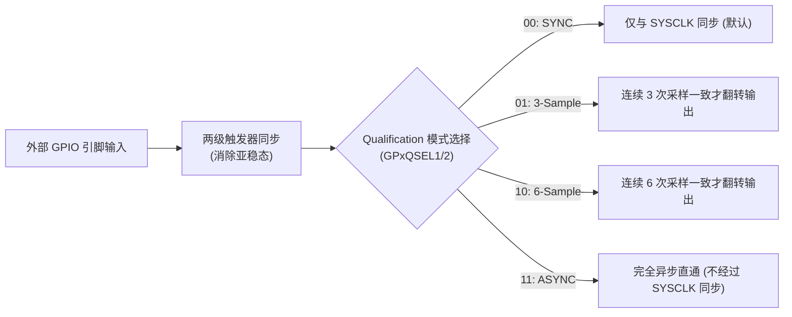

# 01 - GPIO 架构、输入限定滤波 (Qualification) 与 X-BAR 信号路由

> **关联手册**：*TMS320F2837xD Technical Reference Manual (`SPRUHM8K`)* 第 8 章 "General-Purpose Input/Output (GPIO)" & 第 9 章 "Crossbar (X-BAR)"

---

## 1. GPIO 寄存器分组与二级复用机制 (`GPxGMUX` + `GPxMUX`)

F2837xD 共有多达 169 个 GPIO 引脚（`GPIO0` ~ `GPIO168`），每 32 个引脚分为一组（Port A ~ Port F）：
- **Port A**：`GPIO0` ~ `GPIO31`（再细分为低 16 位 `GPAMUX1` 和高 16 位 `GPAMUX2`）
- **Port B**：`GPIO32` ~ `GPIO63`（`GPBMUX1` / `GPBMUX2`）
- **Port C ~ Port F**：以此类推。

### 1.1 二级复用选择（16 选 1）
早期 C2000 每个引脚只有 4 种功能（2-bit `GPxMUX`），而 F2837xD 每个引脚支持多达 16 种外设复用功能，由 **高 2 位组选择寄存器 `GPxGMUX`** 与 **低 2 位选择寄存器 `GPxMUX`** 共同组合出 `0 ~ 15` 的复用编号：
- **硬件切换铁律**：在直接操作寄存器修改引脚复用时，**必须先配置 `GPxGMUX`，再配置 `GPxMUX`**，以防止中间状态瞬间误挂接到其他外设产生毛刺脉冲！
- **DriverLib 封装**：直接调用 `GPIO_setPinConfig(GPIO_28_SCIRXDA);`，函数内部已自动按安全顺序设置 `GPAGMUX2` 和 `GPAMUX2`。

### 1.2 为什么修改输出电平永远应该用 `SET` / `CLEAR` / `TOGGLE`？
千万不要写 `GpioDataRegs.GPADAT.bit.GPIO0 = 1; followed by GpioDataRegs.GPADAT.bit.GPIO1 = 1;`！
- **原因（读-改-写陷阱）**：直接对 `GPADAT` 位域赋值时，CPU 先读回整个 32 位引脚的实时物理外部电平（而非输出锁存器值），修改 1 位后再写回。如果 `GPIO0` 刚被置 `1`，由于引脚电容充电需要几十纳秒，紧接着下一周期执行第二条指令读回 `GPADAT` 时，`GPIO0` 物理引脚电平可能还没升上去（读回为 `0`），写回后就会把 `GPIO0` 重新清零！
- **正确做法**：始终使用写 `1` 有效的原子操作寄存器 **`GPASET`**、**`GPACLEAR`**、**`GPATOGGLE`**（或 DriverLib 的 `GPIO_writePin()` / `GPIO_togglePin()`）。

---

## 2. 硬件输入限定滤波 (Input Qualification) —— 抗电磁干扰神器

在电力电子强开关噪声环境下，按键、限位开关、甚至故障反馈信号极易出现几纳秒的尖峰毛刺。C2000 在每个 GPIO 输入端都内置了硬件数字采样窗滤波器：

- **滤波时间窗计算**：每 8 个 GPIO 共享一个采样周期分频器 `GPxCTRL.QUALPRDn`（分频系数 $K = 1, 2, 4, \dots, 510$）：
  - **3-Sample 模式滤除毛刺宽度**：$T_{\text{filter}} = 2 \times K \times T_{\text{SYSCLK}}$
  - **6-Sample 模式滤除毛刺宽度**：$T_{\text{filter}} = 5 \times K \times T_{\text{SYSCLK}}$

---

## 3. 三大内部信号交叉开关矩阵 (X-BAR)

F2837xD 取消了固定死板的引脚绑定，引入了三个高度灵活的片内硬件信号路由器：

| X-BAR 名称 | 信号流向 | 通道数量 | 典型连接关系（必记！） |
| :--- | :--- | :---: | :--- |
| **Input X-BAR** | 任意 GPIO $\rightarrow$ 片内外设 | `INPUT1` ~ `INPUT14` | - `INPUT1` ~ `INPUT3` $\rightarrow$ **ePWM `TZ1` ~ `TZ3` 外部故障封波** - `INPUT4`, `5`, `6`, `13`, `14` $\rightarrow$ **外部中断 `XINT1` ~ `XINT5`** - `INPUT5` $\rightarrow$ **ADC 外部触发源 `ADCEXTSOC`** - `INPUT7` ~ `INPUT12` $\rightarrow$ **`eCAP1` ~ `eCAP6` 捕获输入** |
| **ePWM X-BAR** | CMPSS / ADC / eCAP / Input X-BAR $\rightarrow$ ePWM DC 子模块 | `TRIP4`, `5`, `7`, `8`, `9`, `10`, `11`, `12` (共8路) | 将片上模拟比较器 **CMPSS 的过压/过流触发信号 (`CTRIPH` / `CTRIPL`)** 路由进 ePWM 的数字比较模块（DC），实现纯硬件保护封波 |
| **Output X-BAR** | CMPSS / ADC / CLBx $\rightarrow$ 外部 GPIO 引脚 | `OUTPUT1` ~ `OUTPUT8` | 将片内无法直接看到的模拟比较器输出电平引到外部 GPIO 管脚，直接用示波器探头抓波形调试 |
