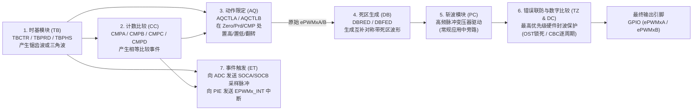

# 02 - ePWM 增强型脉宽调制器深度解析（七大子模块与控制环路协同）

> **关联手册**：*TMS320F2837xD Technical Reference Manual (`SPRUHM8K`)* 第 15 章 "Enhanced Pulse Width Modulator (ePWM)"

C2000 的 ePWM 被公认为业界功能最强大的数字电源与电机控制发波外设。F2837xD 拥有 **12 路独立 ePWM 模块 (`ePWM1` ~ `ePWM12`)**，每路输出一对通道 `ePWMxA` 和 `ePWMxB`。

---

## 1. 单个 ePWM 模块内部七大子模块信号流向图

---

## 2. 周期与占空比计算公式（增计数 vs 增减对称计数）

设 `TBCLK` 频率为 $f_{\text{TBCLK}}$（F2837xD 默认 $f_{\text{EPWMCLK}} = 100\text{ MHz}$，若不分频则 $f_{\text{TBCLK}} = 100\text{ MHz}, T_{\text{TBCLK}} = 10\text{ ns}$），目标开关频率为 $f_{\text{PWM}}$：

| 计数模式 (`CTRMODE`) | 波形特征 | 周期寄存器 `TBPRD` 计算公式 | 典型动作配置（高有效占空比 $D \in [0, 1]$） |
| :--- | :--- | :--- | :--- |
| **增减计数 (`UP_DOWN`)** *(电机 FOC / 逆变器首选)* | **中心对齐对称 PWM**（谐波最小，支持在波谷 `ZERO` 或波峰 `PRD` 无开关噪声点触发 ADC 采样） | $$\text{TBPRD} = \frac{f_{\text{TBCLK}}}{2 \times f_{\text{PWM}}}$$ *(注意：不需要减 1！)* | - **Up 遇 `CMPA` 置低 (`CLEAR`)，Down 遇 `CMPA` 置高 (`SET`)**：此时 $\text{CMPA} = (1 - D) \times \text{TBPRD}$ - **Up 遇 `CMPA` 置高 (`SET`)，Down 遇 `CMPA` 置低 (`CLEAR`)**：此时 $\text{CMPA} = D \times \text{TBPRD}$（注意此时需配合相应极性） |
| **增计数 (`UP`)** *(单端 Buck/Boost 常用)* | 边沿对齐非对称锯齿波 | $$\text{TBPRD} = \frac{f_{\text{TBCLK}}}{f_{\text{PWM}}} - 1$$ | - `TBCTR = ZERO` 置高 (`SET`)，`Up` 遇 `CMPA` 置低 (`CLEAR`) - 此时 $\text{CMPA} = D \times (\text{TBPRD} + 1)$ |

> [!TIP]
> **算例（20 kHz 对称中心对齐 PWM）**：
> 当 $f_{\text{TBCLK}} = 100\text{ MHz}$，$f_{\text{PWM}} = 20\text{ kHz}$ 时：
> $$\text{TBPRD} = \frac{100 \times 10^6}{2 \times 20 \times 10^3} = 2500$$
> 若需要 $1.0\text{ }\mu\text{s}$ 的上下管死区时间，则死区计数值为：
> $$\text{DBRED} = \text{DBFED} = \frac{1.0\text{ }\mu\text{s}}{10\text{ ns}} = 100$$

---

## 3. 死区子模块 (`DB`) 经典极性模式 (`AHC` 互补模式)

配置半桥上下管（上管 `ePWMxA`、下管 `ePWMxB`，均为高电平导通）时，只需在 `AQ` 子模块中配置 **`ePWMxA` 一路波形**，然后将死区模块配置为 **Active High Complementary (`AHC`，高有效互补模式)**：
1. **输入源 (`IN_MODE = 00`)**：上升沿延迟（RED）和下降沿延迟（FED）均以 `ePWMxA` 作为输入源。
2. **极性选择 (`POLSEL = 10`)**：`RED` 不反相（给 `ePWMxA` 上升沿加延迟），`FED` **硬件反相**（把 `ePWMxA` 反相后再给下降沿加延迟输出到 `ePWMxB`）。
3. **输出切换 (`OUT_MODE = 11`)**：同时使能 `RED` 和 `FED` 输出到引脚。

---

## 4. 影子寄存器 (Shadow Register) 与双更新控制模式

如果 CPU 在 `TBCTR` 计数半途直接修改生效中的 `CMPA` 或 `TBPRD`，可能导致当前周期提前错失比较点，产生一个 100% 或 0% 占空比的炸管宽脉冲！
- **影子缓冲机制**：CPU 平时写入的都是 **Shadow Register（影子寄存器）**，硬件只在指定的安全时刻（如 `TBCTR = ZERO` 波谷，或 `TBCTR = TBPRD` 波峰）才在单周期内原子性地将影子值拷入 **Active Register（有效寄存器）**。
- **高频单周期双更新模式（Double Update）**：
  - 将 ADC 触发源设为 `TBCTR = ZERO or PRD`（波谷和波峰各采样 1 次，采样控制频率 = $2 \times f_{\text{PWM}}$）。
  - 将 `CMPA` 装载模式设为 `LOADAMODE = CC_CTR_ZERO_PRD`（波谷计算完的结果立刻在半周期后的波峰生效，控制环路相位滞后减半！）。
