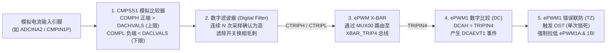

# 03 - ADC 模数转换器与 CMPSS 硬件过流保护全链路

> **关联手册**：*TMS320F2837xD Technical Reference Manual (`SPRUHM8K`)* 第 11 章 "Analog-to-Digital Converter (ADC)" & 第 14 章 "Comparator Subsystem (CMPSS)"

---

## 1. F2837xD ADC 核心架构：通道与 SOC 解耦设计

与传统单片机“按通道号固定顺序扫描”不同，C2000 ADC 采用 **SOC（Start-of-Conversion，转换配置槽）** 架构：
- 每个 ADC 模块（`ADCA`, `ADCB`, `ADCC`, `ADCD`）内部有 **16 个独立的配置槽（`SOC0` ~ `SOC15`）** 和对应的 **16 个结果寄存器（`ADCRESULT0` ~ `ADCRESULT15`）**。
- **每个 `SOCn` 自由配置三要素**：
  1. **`TRIGSEL`（谁来触发我？）**：例如 `ePWM1_SOCA`、CPU Timer0、软件强制等。
  2. **`CHSEL`（我去采哪个模拟引脚？）**：例如 `ADCIN0` ~ `ADCIN15`。
  3. **`ACQPS`（采样保持电容闭合充多久的电？）**：采样窗时长 = $(\text{ACQPS} + 1) \times T_{\text{SYSCLK}}$。

### 1.1 多路真正同步采样技巧（四核 ADC 并行）
在三相电机 FOC 或三相逆变器中，我们需要在**同一时刻**采样 $I_a, I_b, I_c$ 三相电流，消除顺序采样带来的相角差：
- 将 $I_a$ 接在 **`ADCA_IN0`**，$I_b$ 接在 **`ADCB_IN0`**，$I_c$ 接在 **`ADCC_IN0`**。
- 将 `ADCA` 的 `SOC0`、`ADCB` 的 `SOC0`、`ADCC` 的 `SOC0` 的触发源**全部配置为同一个 `ADC_TRIGGER_EPWM1_SOCA`**！
- 当 `ePWM1` 到达 `TBCTR = ZERO` 发出 `SOCA` 脉冲时，`ADCA`、`ADCB`、`ADCC` 三个独立的采样保持开关在同一纳秒同时闭合，仅用 1 路通道的转换时间（约 $260\text{ ns}$）即可同时拿到三相电流结果，此时只需开启 `ADCA1` 一路中断去读取三个模块的结果即可！

---

## 2. CMPSS + ePWM X-BAR + ePWM TZ 纯硬件过流封波全链路

在电力电子实验中，软件在 ADC 中断里判断 `if (current > limit)` 再关断 PWM 往往需要 $2 \sim 10\text{ }\mu\text{s}$ 延迟，遇到硬短路时功率管早已炸毁。C2000 的标准做法是**把模拟电流信号同时送入 CMPSS 片上比较器，走纯硬件通路直接封锁 ePWM**：



### 2.1 完整 DriverLib 配置代码模板（正负双向硬件过流锁死保护）

```c
#include "driverlib.h"
#include "device.h"

void initCMPSS1_OverCurrentTrip_EPWM1(uint16_t dacHighLimit, uint16_t dacLowLimit)
{
    // ==================== 1. 配置 CMPSS1 高低比较器与内部 DAC ====================
    SysCtl_enablePeripheral(SYSCTL_PERIPH_CLK_CMPSS1);
    CMPSS_enableModule(CMPSS1_BASE);

    // 高比较器：反相端接内部 DAC；低比较器：反相端接内部 DAC 且将输出逻辑反相（低于下限时输出高！）
    CMPSS_configHighComparator(CMPSS1_BASE, CMPSS_INSRC_DAC);
    CMPSS_configLowComparator(CMPSS1_BASE, CMPSS_INSRC_DAC | CMPSS_INV_INVERTED);

    // 使用 VDDA (3.3V) 作为 DAC 基准，写入正负过流阈值（如零点 2048，上限 3500，下限 600）
    CMPSS_configDAC(CMPSS1_BASE, CMPSS_DACREF_VDDA | CMPSS_DACVAL_SYSCLK | CMPSS_DACSRC_SHDW);
    CMPSS_setDACValueHigh(CMPSS1_BASE, dacHighLimit);
    CMPSS_setDACValueLow(CMPSS1_BASE, dacLowLimit);

    // 配置数字滤波器：分频=2, 窗口=10, 阈值=7 (约 100ns 消抖)
    CMPSS_configFilterHigh(CMPSS1_BASE, 2U, 10U, 7U);
    CMPSS_configFilterLow(CMPSS1_BASE, 2U, 10U, 7U);
    CMPSS_initFilterHigh(CMPSS1_BASE);
    CMPSS_initFilterLow(CMPSS1_BASE);

    // 将数字滤波器输出连接至 CTRIPH 和 CTRIPL
    CMPSS_configOutputsHigh(CMPSS1_BASE, CMPSS_TRIP_FILTER | CMPSS_TRIPOUT_FILTER);
    CMPSS_configOutputsLow(CMPSS1_BASE, CMPSS_TRIP_FILTER | CMPSS_TRIPOUT_FILTER);

    // ==================== 2. 配置 ePWM X-BAR 将 CMPSS1 路由到 TRIP4 ====================
    // MUX00 的选项 CMPSS1_CTRIPH_OR_L 同时合并了高阈值越界与低阈值越界！
    XBAR_setEPWMMuxConfig(XBAR_TRIP4, XBAR_EPWM_MUX00_CMPSS1_CTRIPH_OR_L);
    XBAR_enableEPWMMux(XBAR_TRIP4, XBAR_MUX00);

    // ==================== 3. 配置 ePWM1 DC 与 TZ 子模块执行硬件封波 ====================
    // 将 TRIP4 选作 DCAH 输入，当 DCAH 为高电平时产生 DCAEVT1 事件
    EPWM_selectDigitalCompareTripInput(EPWM1_BASE, EPWM_DC_TRIP_TRIPIN4, EPWM_DC_TYPE_DCAH);
    EPWM_setTripZoneDigitalCompareEventCondition(EPWM1_BASE, EPWM_TZ_DC_OUTPUT_A1, EPWM_TZ_EVENT_DCXH_HIGH);
    EPWM_setDigitalCompareEventSource(EPWM1_BASE, EPWM_DC_MODULE_A, EPWM_DC_EVENT_1, EPWM_DC_EVENT_SOURCE_ORIG_SIGNAL);
    EPWM_setDigitalCompareEventSyncMode(EPWM1_BASE, EPWM_DC_MODULE_A, EPWM_DC_EVENT_1, EPWM_DC_EVENT_INPUT_NOT_SYNCED);

    // 使能 DCAEVT1 作为 One-Shot (OST) 单次锁死触发源，发生故障时强制拉低 ePWM1A 和 ePWM1B！
    EPWM_enableTripZoneSignals(EPWM1_BASE, EPWM_TZ_SIGNAL_DCAEVT1);
    EPWM_setTripZoneAction(EPWM1_BASE, EPWM_TZ_ACTION_EVENT_TZA, EPWM_TZ_ACTION_LOW);
    EPWM_setTripZoneAction(EPWM1_BASE, EPWM_TZ_ACTION_EVENT_TZB, EPWM_TZ_ACTION_LOW);

    // 清零初始故障标志
    EPWM_clearTripZoneFlag(EPWM1_BASE, EPWM_TZ_FLAG_OST | EPWM_TZ_FLAG_DCAEVT1 | EPWM_TZ_INTERRUPT);
}
```
