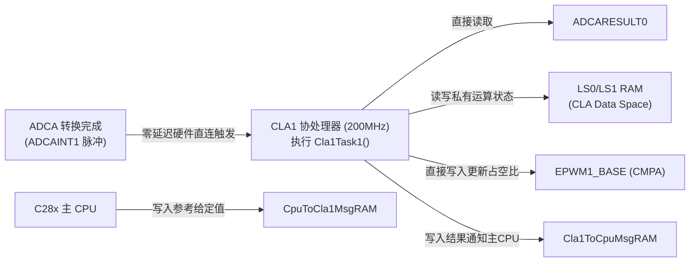

# 01 - CLA 控制律加速器 (Control Law Accelerator) 编程全指南

> **关联手册**：*TMS320F2837xD Technical Reference Manual (`SPRUHM8K`)* 第 6 章 "Control Law Accelerator (CLA)"

F2837xD 的每个主 CPU 核都配备了一个同频（200 MHz）运行的独立 32-bit 浮点协处理器——**CLA (Type-1)**。它的核心使命是：**不经过主 CPU 中断，由 ADC 转换完成事件直接硬件触发 CLA 读取 `ADCRESULT`、算完 PID/FOC 控制律后直接更新 `ePWM.CMPA`**，从而将主 CPU 从几十 kHz 的控制中断中彻底解放出来！

---

## 1. CLA 架构特点与与主 CPU 的差异



### 1.1 编写 `.cla` 源码的四大语法限制（极其重要！）
CLA 代码写在以 **`.cla`** 为后缀的文件中，由专门的 CLA 编译器编译。由于 CLA 没有硬件堆栈指针 `SP`（只有少量固定寄存器 `MR0`~`MR3`, `MAR0`~`MAR1`, `MPC`, `MRPC`），它有严格的 C 语言子集限制：
1. **指针宽度为 16-bit（仅能寻址低 64K Words `0x0000 ~ 0xFFFF`）**：
   - 在 C28x 主 CPU 上 `sizeof(void*) == 2`（32位）；而在 `.cla` 中 **`sizeof(void*) == 1`（16位）**！
   - **铁律**：如果你在 `CpuToCla1MsgRAM` 共享结构体里放了一个指针成员，主 CPU 认为是 32 位，CLA 认为是 16 位，会导致后续所有结构体成员偏移错位！若必须在共享结构体中放指针，需用 union 补齐 32 位。
2. **Task 1 ~ Task 8 之间不可互相抢占（无嵌套），但支持单级子函数调用**。
3. **注意 C 数据类型差异**：在 `.cla` 中，**`int` 是 32 位（而在 C28x 中 `int` 是 16 位）**！因此在 CPU 与 CLA 共享的头文件（如 `cla_shared.h`）中，**严禁使用 `int`**，必须一律使用 `<stdint.h>` 的 `int16_t`、`uint16_t`、`int32_t`、`float`！
4. **CLA 只能访问**：`LS0 ~ LS5`（需主 CPU 授权）、`CpuToCla1MsgRAM`、`Cla1ToCpuMsgRAM` 以及**受支持的控制外设寄存器（ADC 结果、ePWM、CMPSS、eCAP、eQEP、SDFM）**。CLA **不能访问** `M0/M1`、`D0/D1`、`GS0~GS15`！

---

## 2. CLA 内存与链接脚本 (`.cmd`) 标准配置

要让 CLA 工作，需要在 `.cmd` 中配置三个专属段：
1. **`Cla1Prog`**：存放 `.cla` 编译出的指令机器码（`LOAD = FLASHD, RUN = RAMLS4`）。
2. **`Cla1DataRam`** / **`.bss_cla`**：存放 CLA 私有的全局变量（分配在 `RAMLS0` 或 `RAMLS1`）。
3. **`CpuToCla1MsgRAM` & `Cla1ToCpuMsgRAM`**：存放主 CPU 与 CLA 交互的变量。

```text
SECTIONS
{
    /* CLA 程序段：存放在 Flash，上电由主 CPU 拷贝到 LS4 后再把 LS4 移交给 CLA */
    Cla1Prog        : LOAD = FLASHD,
                      RUN = RAMLS4_LS5,
                      LOAD_START(_Cla1funcsLoadStart),
                      LOAD_SIZE(_Cla1funcsLoadSize),
                      RUN_START(_Cla1funcsRunStart),
                      PAGE = 0, ALIGN(4)

    .bss_cla        : > RAMLS0,          PAGE = 1
    .const_cla      : LOAD = FLASHD,
                      RUN = RAMLS1,
                      RUN_START(_Cla1ConstRunStart),
                      LOAD_START(_Cla1ConstLoadStart),
                      LOAD_SIZE(_Cla1ConstLoadSize),
                      PAGE = 1, ALIGN(4)

    CpuToCla1MsgRAM : > CPU_TO_CLA1_MSGRAM, PAGE = 1
    Cla1ToCpuMsgRAM : > CLA1_TO_CPU_MSGRAM, PAGE = 1
}
```

---

## 3. 主 CPU 初始化 CLA 的黄金五步法

```c
void initCLA1(void)
{
    // 【第1步】当主 CPU 还拥有 LS4_LS5 写权限时，先把 CLA 代码和常量从 Flash 拷贝到 LSx RAM！
#ifdef _FLASH
    memcpy((uint32_t *)&Cla1funcsRunStart, (uint32_t *)&Cla1funcsLoadStart, (uint32_t)&Cla1funcsLoadSize);
    memcpy((uint32_t *)&Cla1ConstRunStart, (uint32_t *)&Cla1ConstLoadStart, (uint32_t)&Cla1ConstLoadSize);
#endif

    // 【第2步】初始化双向 Message RAM（硬件自动清零）
    MemCfg_initSections(MEMCFG_SECT_MSGCLA1TOCPU | MEMCFG_SECT_MSGCPUTOCLA1);
    while(!MemCfg_getInitStatus(MEMCFG_SECT_MSGCLA1TOCPU | MEMCFG_SECT_MSGCPUTOCLA1)) {}

    // 【第3步】将 LS4/LS5 划为 CLA 程序空间，将 LS0/LS1 划为 CLA 数据空间
    // 注意：一旦设为 CLA_MEM_PROGRAM，主 CPU 就无法再向 LS4/LS5 写入任何数据！所以第1步必须在第3步之前！
    MemCfg_setLSRAMMasterSel(MEMCFG_SECT_LS4 | MEMCFG_SECT_LS5, MEMCFG_LSRAMMASTER_CPU_CLA1);
    MemCfg_setCLAMemType(MEMCFG_SECT_LS4 | MEMCFG_SECT_LS5, MEMCFG_CLA_MEM_PROGRAM);

    MemCfg_setLSRAMMasterSel(MEMCFG_SECT_LS0 | MEMCFG_SECT_LS1, MEMCFG_LSRAMMASTER_CPU_CLA1);
    MemCfg_setCLAMemType(MEMCFG_SECT_LS0 | MEMCFG_SECT_LS1, MEMCFG_CLA_MEM_DATA);

    // 【第4步】将 Cla1Task1 ~ Task8 的入口地址填入 MVECT1 ~ MVECT8（16位偏移地址）
    CLA_mapTaskVector(CLA1_BASE, CLA_MVECT_1, (uint16_t)&Cla1Task1);
    CLA_mapTaskVector(CLA1_BASE, CLA_MVECT_8, (uint32_t)&Cla1Task8); // Task8 常用于一次性初始化 CLA 内部状态变量

    // 【第5步】设置 Task1 的硬件触发源为 ADCA1，使能任务，并用软件触发一次 Task8 完成初始化
    CLA_setTriggerSource(CLA_TASK_1, CLA_TRIGGER_ADCA1);
    CLA_enableIACK(CLA1_BASE); // 允许主 CPU 用 asm(" IACK #0x0080") 软件触发 CLA 任务
    CLA_enableTasks(CLA1_BASE, CLA_TASKFLAG_1 | CLA_TASKFLAG_8);
    CLA_forceTasks(CLA1_BASE, CLA_TASKFLAG_8);
}
```
> [!TIP]
> **如何在 CCS 中单步调试 `.cla` 代码？**
> 1. 在 `.cla` 文件的某一行插入 **`__mdebugstop();`**（编译为 `MDEBUGSTOP` 硬件断点指令，不连接仿真器时等价于 `MNOP` 空指令）。
> 2. 在 CCS Debug 窗口中，右键点击 **`Texas Instruments XDS100v2 USB Debug Probe_0/C28xx_CPU1_CLA1`** $\rightarrow$ 选择 **`Connect Target`**！
> 3. 当主 CPU 触发该 CLA Task 时，CLA 核就会自动停在 `__mdebugstop();` 处，此时可以像调普通 C 代码一样按 `F5`/`F6` 单步执行 CLA！
