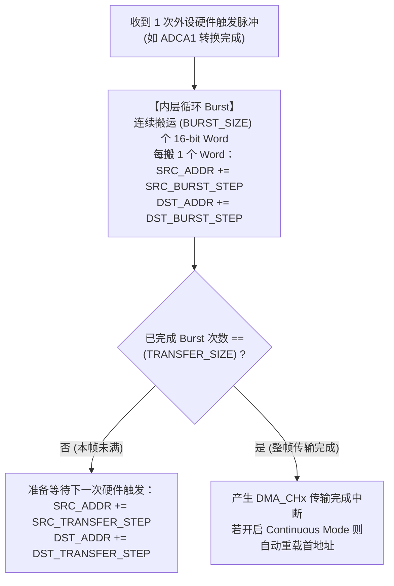

# 02 - DMA 直接内存访问控制器（二维地址步进与乒乓缓冲）

> **关联手册**：*TMS320F2837xD Technical Reference Manual (`SPRUHM8K`)* 第 5 章 "Direct Memory Access (DMA)"

F2837xD 每个 CPU 核包含一个 6 通道（`CH1` ~ `CH6`）的 DMA 控制器。它可以由 ADC、ePWM、McBSP、SPI、外部中断等几十种事件触发，在后台不占 CPU 周期完成数据搬运、矩阵转置（多通道交错数据解交织）和乒乓缓存。

---

## 1. DMA 总线矩阵限制（再三强调！）

DMA 总线**没有连接**到 `M0/M1`、`D0/D1` 和 `LS0~LS5`！
- **DMA 可访问的 RAM 区域**：仅限 **`GS0 ~ GS15` 全局共享 RAM** 以及 **`CPU1TOCPU2RAM` / `CPU2TOCPU1RAM`**！
- **DMA 可访问的外设寄存器**：`ADCARESULT` ~ `ADCDRESULT`、ePWM、McBSP、SPI、EMIF。
- *(注意：SCI/UART、I2C 和 CAN 寄存器不支持 DMA 直接访问！)*

---

## 2. 二维循环寻址机制：Burst（内层循环）与 Transfer（外层循环）

C2000 DMA 强大之处在于它内置了**两层嵌套的硬件地址步进计算器**，不仅能顺序拷贝，还能在搬运的同时直接将 `[Ia0, Ib0, Ic0, Ia1, Ib1, Ic1...]` 自动按通道分拣拆成三个独立连续数组 `Ia[N]`, `Ib[N]`, `Ic[N]`！



### 2.1 经典案例：将 3 个 ADC 结果寄存器自动解交织存入二维数组 `adcLog[3][100]`

假设每次 PWM 周期触发 `ADCA` 转换 `SOC0`、`SOC1`、`SOC2`（结果位于连续地址 `ADCARESULT0`, `1`, `2`），我们希望连续采集 `100` 个周期，且自动按通道分开存进 `uint16_t adcLog[3][100]`（即 `adcLog[0][0..99]` 存第0通道，`adcLog[1][0..99]` 存第1通道）：

- **内层循环 (`Burst`)**：每次 ADC 触发搬运 **3 个 Words**（`size = 3`）：
  - 源地址步进 `srcBurstStep = +1`（依次读 `RESULT0` $\rightarrow$ `RESULT1` $\rightarrow$ `RESULT2`）。
  - 目的地址步进 `destBurstStep = +100`（依次写 `adcLog[0][k]` $\rightarrow$ `adcLog[1][k]` $\rightarrow$ `adcLog[2][k]`，跨行步进 100！）。
- **外层循环 (`Transfer`)**：共触发 **100 次 Burst**（`transferSize = 100`）：
  - 每次 Burst 搬完第 3 个元素（此时源地址指在 `RESULT2`，目的地址指在 `adcLog[2][k]`）后：
  - 源地址步进 `srcTransferStep = -2`（从 `RESULT2` 退回 `RESULT0`！）。
  - 目的地址步进 `destTransferStep = 1 - 200 = -199`（从 `adcLog[2][k]` 跳到下一列开头 `adcLog[0][k+1]`！）。

```c
#pragma DATA_SECTION(adcLog, "ramgs0"); // 必须放在 GSx RAM!
volatile uint16_t adcLog[3][100];

void initDMA_ADCDeinterleave(void)
{
    DMA_initController();

    // 配置源地址为 ADCARESULT0，目的地址为 adcLog 首地址
    DMA_configAddresses(DMA_CH1_BASE, (const void *)adcLog, (const void *)ADCARESULT_BASE);

    // 内层 Burst：每次触发搬 3 个 Word，源步进 +1，目的步进 +100
    DMA_configBurst(DMA_CH1_BASE, 3U, 1, 100);

    // 外层 Transfer：共 100 次触发，每次 Burst 后源地址退 2 (-2)，目的地址退 199 (-199)
    DMA_configTransfer(DMA_CH1_BASE, 100U, -2, -199);

    // 触发源选 ADCA1，16位模式，连续循环模式
    DMA_configMode(DMA_CH1_BASE, DMA_TRIGGER_ADCA1,
                   DMA_CFG_ONESHOT_DISABLE | DMA_CFG_CONTINUOUS_ENABLE | DMA_CFG_SIZE_16BIT);

    DMA_setInterruptMode(DMA_CH1_BASE, DMA_INT_AT_END);
    DMA_enableInterrupt(DMA_CH1_BASE);
    DMA_enableTrigger(DMA_CH1_BASE);
    DMA_startChannel(DMA_CH1_BASE);
}
```
> [!NOTE]
> DriverLib 的 `DMA_configBurst(base, size, ...)` 和 `DMA_configTransfer(base, transferSize, ...)` 内部已经自动帮你对 `size` 和 `transferSize` 执行了 `- 1` 写入硬件寄存器，因此调用 DriverLib 时直接传真实个数（如 `3U` 和 `100U`）即可！
