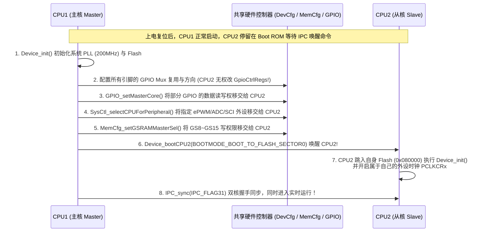

# 03 - 双核架构 (CPU1 & CPU2)：启动引导、外设分配与 IPC 通信

> **关联手册**：*TMS320F2837xD Technical Reference Manual (`SPRUHM8K`)* 第 3.6 节 "Watchdog and Dual-Core Systems" & 第 6 章 "Inter-Processor Communications (IPC)"

TMS320F2837xD 是一颗非对称主从式（Master-Slave）双核 MCU：
- **CPU1（主控核 Master）**：独占管理系统时钟（PLL）、GPIO 复用与方向配置（`GpioCtrlRegs`）、外设归属权分配（`DevCfgRegs.CPUSELx`）以及全局共享内存分配（`MemCfgRegs.GSxMSEL`）。
- **CPU2（从属核 Slave）**：拥有完全相同的 200 MHz C28x+FPU+TMU+VCU 内核、独立 Flash/M0/M1/D0/D1/LSx、独立 CLA2 和 DMA2，但**必须由 CPU1 移交外设使用权并发送 IPC 启动命令后才能开始工作**。

---

## 1. 双核上电启动与资源移交标准时序图



---

## 2. 双核开发的四大黄金法则（避坑必看！）

### 法则 1：CPU2 绝对不能修改 `GpioCtrlRegs`（引脚复用与方向）！
在硬件设计上，整个芯片只有一套 `GpioCtrlRegs`，且**只有 CPU1 有写权限**！
- **正确做法**：哪怕某个引脚（如 `GPIO2` 作 `ePWM2A` 或 `GPIO34` 作 LED）是给 CPU2 用的，它的 **`GPIO_setPinConfig()` 和 `GPIO_setDirectionMode()` 也必须在 CPU1 的初始化代码里完成**！
- 如果 CPU2 需要在运行时翻转 `GPIO34` 的电平（写 `GpioDataRegs`），CPU1 还要额外加一句：
  ```c
  GPIO_setMasterCore(34U, GPIO_CORE_CPU2); // 将 GPIO34 的 GPxDAT/SET/CLEAR 控制权移交给 CPU2
  ```

### 法则 2：移交外设给 CPU2 后，外设时钟门控 (`PCLKCRx`) 必须由 CPU2 自己开启！
当 CPU1 调用 `SysCtl_selectCPUForPeripheral(SYSCTL_CPUSEL0_EPWM, 2, SYSCTL_CPUSEL_CPU2)` 把 `ePWM2` 移交给 CPU2 后：
- `ePWM2` 的时钟门控开关就自动切换到了 **CPU2 自己的 `CpuSysRegs.PCLKCR2.bit.EPWM2`** 下。
- 因此，**必须在 CPU1 完成外设归属权分配（通过 `IPC_sync` 同步确认）之后，再由 CPU2 调用 `SysCtl_enablePeripheral(SYSCTL_PERIPH_CLK_EPWM2)` 开启时钟并初始化 `ePWM2` 寄存器**！

### 法则 3：CPU1 如何引导 CPU2 启动（仿真调试 vs 脱机独立运行）
- **连接仿真器调试时**：你可以在 CCS 里分别给 CPU1 和 CPU2 下载 `.out` 程序并点击运行，无需 Boot 引导。
- **拔掉仿真器脱机独立上电（Standalone Flash）时**：必须在 CPU1 的代码中调用：
  ```c
  #ifdef _STANDALONE
  // 通知 CPU2 的 Boot ROM 跳转到 CPU2 自己的 Flash 入口 (0x080000) 启动！
  Device_bootCPU2(C1C2_BROM_BOOTMODE_BOOT_FROM_FLASH);
  #endif
  ```

---

## 3. 双核 IPC 通信的三种实用模式

### 模式 1：双核启动屏障握手 (`IPC_sync`)
确保 CPU1 已经把外设和 `GSx` RAM 全部分配妥当后，CPU2 才开始操作外设：
```c
// 在 CPU1 完成所有资源移交后调用：
IPC_sync(IPC_CPU1_L_CPU2_R, IPC_FLAG31);

// 在 CPU2 的 main() 开头（初始化外设之前）调用：
IPC_sync(IPC_CPU2_L_CPU1_R, IPC_FLAG31);
```

### 模式 2：利用 `CPU1TOCPU2RAM` / `CPU2TOCPU1RAM` 传递控制结构体 + `IPC_FLAG` 通知
每个方向有 `1K Words` 专属消息 RAM，天然无写冲突（`CPU1TOCPU2RAM` 仅 CPU1 可写、CPU2 只读）：
```c
// 发送方 (CPU1)：
if (!IPC_isFlagBusyLtoR(IPC_CPU1_L_CPU2_R, IPC_FLAG10)) // 确认上一帧已被 CPU2 读取应答
{
    g_cpu1ToCpu2Msg.targetSpeedRPM = 1500.0f;
    g_cpu1ToCpu2Msg.enableDrive    = 1U;
    IPC_setFlagLtoR(IPC_CPU1_L_CPU2_R, IPC_FLAG10);     // 置位标志通知 CPU2
}

// 接收方 (CPU2)：
if (IPC_isFlagBusyRtoL(IPC_CPU2_L_CPU1_R, IPC_FLAG10))
{
    localSpeedRef = g_cpu1ToCpu2Msg.targetSpeedRPM;
    localEnable   = g_cpu1ToCpu2Msg.enableDrive;
    IPC_ackFlagRtoL(IPC_CPU2_L_CPU1_R, IPC_FLAG10);     // 清除标志位应答 CPU1！
}
```
*(若希望接收方立即进中断响应，使用 `IPC_FLAG0` ~ `IPC_FLAG3` 并注册 `INT_IPC_0` ~ `INT_IPC_3` 即可。)*
